<p align="center">
  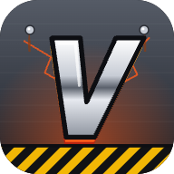
</p>

<h1 align="center">VROOM</h1>

<p align="center">
  A late-90s console style metal grunge 3D racer. Monster machines, twelve loud worlds, 120 tracks,
  creatures that lunge out of the scenery and a boss chasing you to every tenth flag.
  One HTML file, no reading, works offline.
</p>

<p align="center">
  <a href="https://zacker3310.github.io/vroom/"><strong>Play it: zacker3310.github.io/vroom</strong></a>
</p>

<p align="center">
  <a href="https://github.com/zacker3310/vroom/actions/workflows/test.yml"></a>
  
  
  
</p>

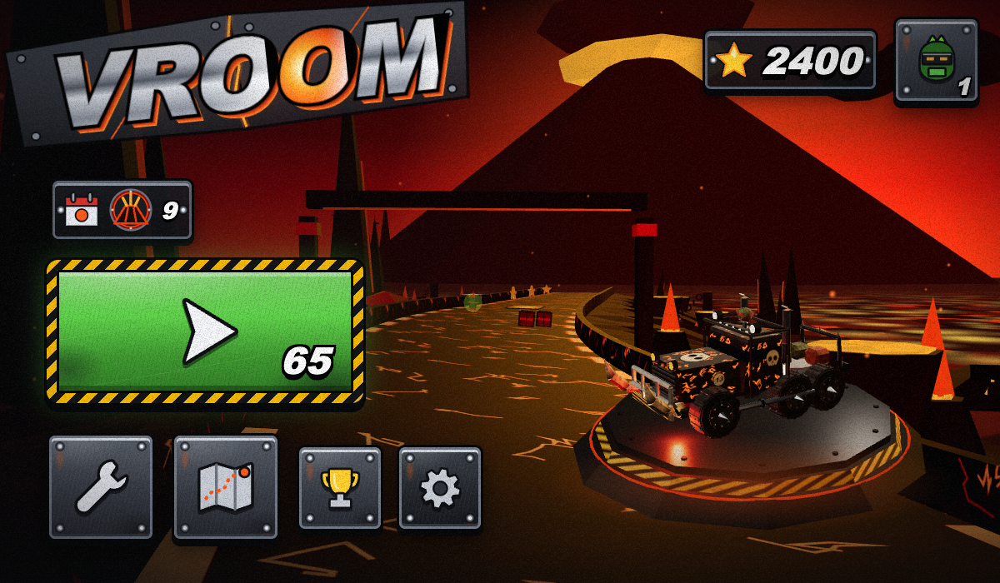

## Highlights

- **A real 3D racer.** three.js r170, inlined into the one shipped file. Chunky low-poly machines, flat-shaded worlds, hard rim light, heavy fog, shadows from the key light, sparks, smoke, skid marks and nitro flame.
- **Real vehicle physics.** A rigid body on four raycast spring-damper wheels, slip-angle tyres with a friction ellipse, per-surface grip, gears and rpm, drift with counter-steer and a boost bank, airtime with flips, rolls and spins, bump stops, wall glances that keep your speed, true vertical loops and corkscrews. Deterministic and fixed-step (120 Hz, no `Math.random`, no clocks), so it ports bit-exact to Swift for the iOS build.
- **31 machines.** Every v12 vehicle rebuilt as a heavy machine of scrap and plate (the starter Mauler monster truck, an excavator crawler, a stretch hearse, a steam locomotive on monster tyres, a twin-turbine hover ship) plus eight new ones: a six-wheel war rig with ram tusks, the heaviest ore hauler, a spiked rotor dragster, a long-travel dune buggy, a giant-wheel mining dumper, an 8x8 armoured carrier, a blown hot rod and a crane-hook wrecker. Six classes that drive differently: brute, hauler, racer, tank, hover, freak. 20 wheel sets, 32 paints with metal finishes, 14 decals, 18 bolt-on extras, 12 dashboard buddies, a race number, five upgrade ladders.
- **Twelve loud worlds, 120 tracks.** Scrapyard Foundry, Ember Canyon, Neon Necropolis, Drown Docks, Frostbite Pass, Scorch Flats, Wreck Cove, Orbital Scrapheap (low gravity), Magma Forge, Rot Sugar Carnival, Abyss Trench (a glass tube on the sea floor) and Storm Citadel. Each has its own sky, road, walls, roadside sets, weather, horizon landmark, riff and ambience. Tracks are built from loops, corkscrews, halfpipes, split lanes, banked bowls, mega ramps over gaps, rope bridges and tunnels.
- **Monsters.** Two creature kinds in every world (lurkers that tell and lunge, packs that cross the road, divers whose shadow marks the spot, burrowers whose wake hunts your lane) and a boss on every finale that rubber-bands behind you, surges alongside and throws, sweeps, rolls and charges. Ram it while it is dazed to smash it for bonus stars. All original designs.
- **Race your ghost.** Your best run on every level is stored as its packed inputs and replayed through the same deterministic sim as a translucent twin.
- **Nothing to read, nothing to lose.** Pictograms and numerals only (the logo is the one word). Crashes, monsters and gaps knock you back and cost time; a crane hook puts you back on the road. Every race finishes. Stars only go up.
- **Your old save still works.** Every v12 save, profile and save code (the QR included) loads with its stars, unlocks and parts.

## Screenshots

| Splash | Garage |
|---|---|
| 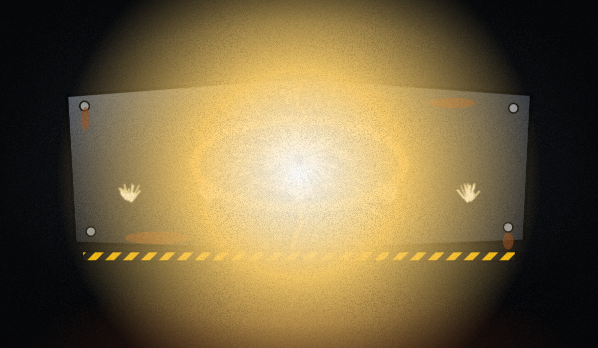 | 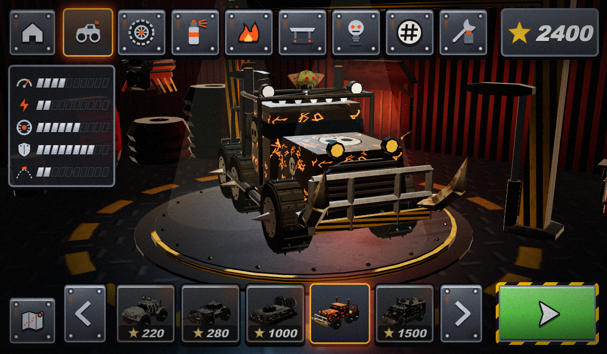 |

| Map | Boss chase |
|---|---|
| 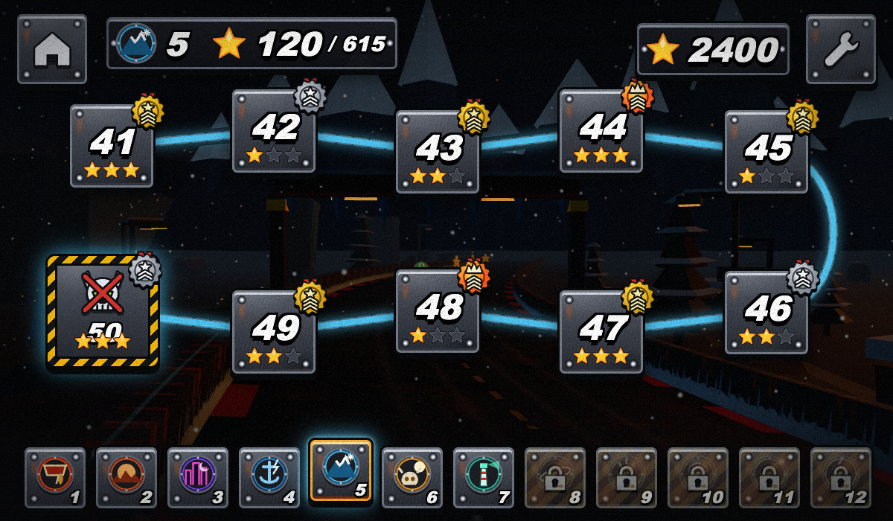 | 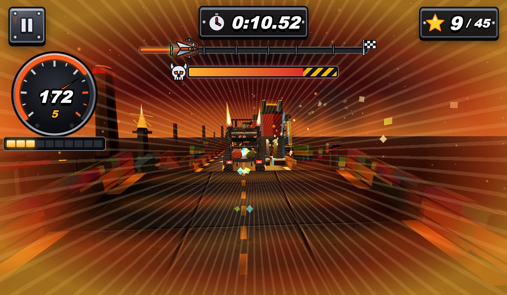 |

| Worlds | |
|---|---|
| 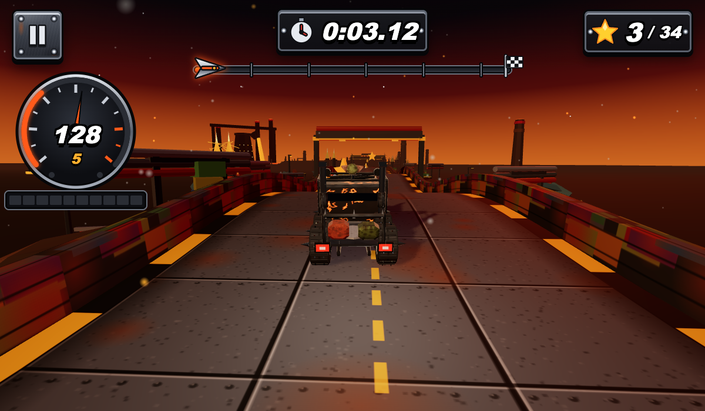 | 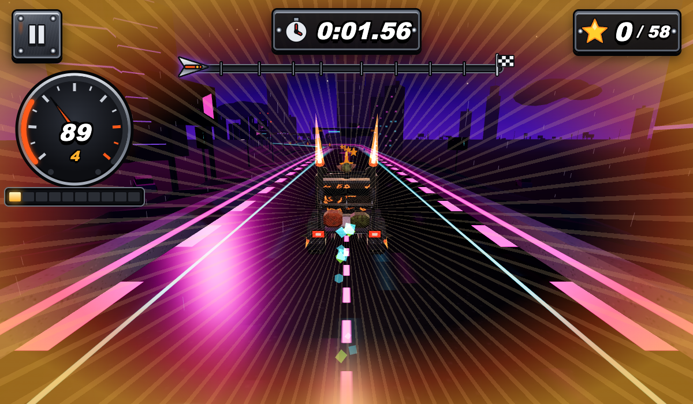 |
| 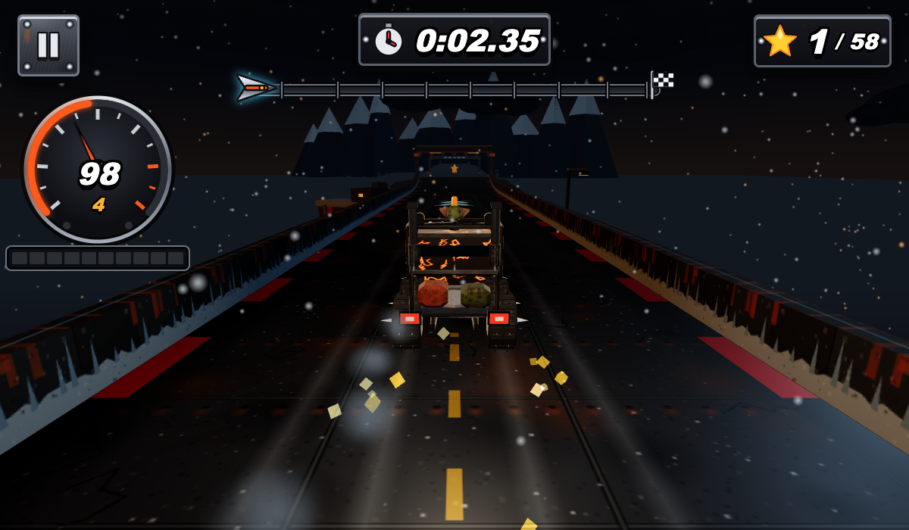 | 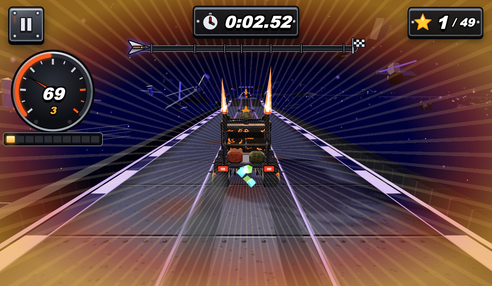 |
| 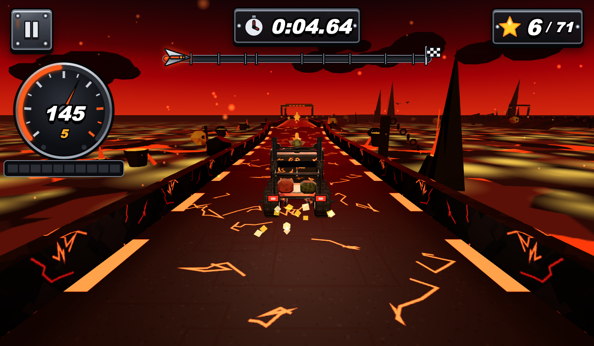 | 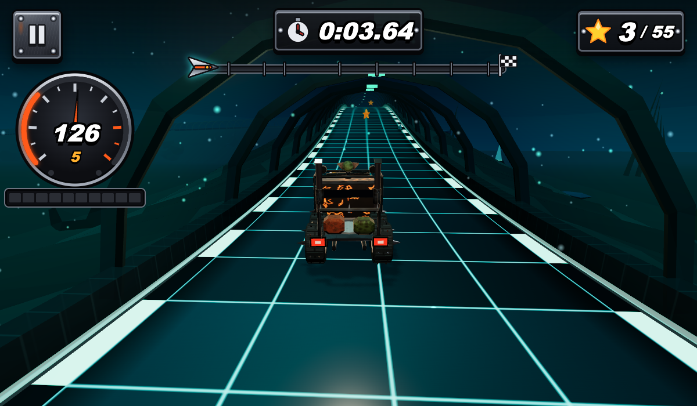 |
| 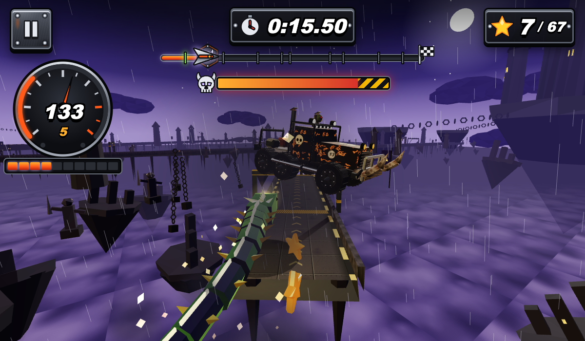 | |

## How to play

**Home.** The world of the day behind you, your machine idling on a podium (tap it to rev). The big hazard GO races your next level; the plates open the garage, the map, the trophy album and settings; the avatar opens profiles.

**The race.** Gas, brake, boost and drift plates on the right; drag anywhere on the left to steer (or switch to tilt or left/right plates in settings). A countdown of three red lamps and a green, then go. Hold drift through a corner and counter-steer to bank boost. In the air, steer strafes, brake flips you backwards, drift spins, drift with gas front-flips; land upright for more boost. The rail across the top shows checkpoints, the flag, you, your ghost and on finales the boss.

| | Touch | Keyboard | Gamepad |
|---|---|---|---|
| Gas / brake | green / red plates | W S or arrows | triggers |
| Steer | drag on the left, tilt, or plates | A D or arrows (hold for full lock) | left stick |
| Boost / drift | lightning / drift plates | space / shift or X | face buttons |
| Pause | top-left plate | Esc or P | start |

**Results.** A gunmetal card slams down: time, a medal (S, A, B, C as chevrons), 1 to 3 stars for the stars you collected, air, drift, tricks and hits, and the payout ticking into your wallet.

**The garage.** Your machine on a turntable in a night foundry. Eight tabs: body, wheels, paint, decal, extras, buddy, number and the workbench (engine, armour, magnet, boost tank, springs, and repair). Locked parts sit rusted with a star price; tap to preview, tap the hazard plate to buy and it bolts on with sparks.

## For grown-ups

- **Profiles.** Three players, each a face, each with their own save.
- **Save codes and QR.** The profile panel shows a scan-to-open QR and copy / paste plates for the full code; `https://zacker3310.github.io/vroom/#save=<code>` imports one after a wordless confirm. Codes from v12 still work.
- **Sound.** Settings holds quiet mode, the optional CRT scanlines, the steering mode and three sensitivities.
- **Home screen.** From Safari, Share, Add to Home Screen: full-screen landscape, offline. There is also a native iOS shell in `ios/`.
- **Updates.** When a new version is live a green hazard plate with a refresh ring appears on home, under the avatar. Press and hold until the ring fills and the game reloads into it; progress is kept.
- **Where progress lives.** The browser's local storage on the device. Export a save code before clearing website data.

## Design principles

The test suite enforces these:

1. **Zero words on screen.** Numerals, symbols and pictograms only; the VROOM logo is the one word (`data-logo`).
2. **No fail states.** Nothing ends a run; a monster knock costs at most a second of control; stars only go up.
3. **Every tap target is at least 64 px** rendered on an iPad in landscape (1024x768).
4. **Reduced motion is honoured** for everything decorative: shake, glints, sway, idle bobs, weather.
5. **Save data is forever.** Catalog orders and save-code lists are append-only; v12 saves and codes load.
6. **Fair.** An autopilot at skill 0.4 finishes every level under twice par B; at skill 1 it reaches par A.
7. **Original.** A late-90s console *style*; no characters, names, art or music from any existing game.

## Architecture

`src/` holds the modules; `npm run build` wraps each in its own `<script>` and inlines three.js into
the one shipped `index.html`. The deterministic sim region (contracts, dmath, catalog, levels, sim,
monster behaviour) is DOM-free and THREE-free and runs in Node for the tests. See
[docs/ARCHITECTURE.md](docs/ARCHITECTURE.md) for the tour and [docs/OVERHAUL.md](docs/OVERHAUL.md) for
the v13 design.

## Development

```bash
git clone https://github.com/zacker3310/vroom.git
cd vroom
npm ci                                   # three, eslint, playwright-core, jsqr (build and test only)
npx playwright-core install chromium     # or: export CHROMIUM=/path/to/chrome
npm run build                            # src/ -> index.html
python3 -m http.server 4173              # then open http://localhost:4173/ (append ?garage, ?level=N, ?world=N)
npm test                                 # 16 suites, 461 checks
node tests/lint.cjs                      # 0 findings
node scripts/doc-shots.cjs               # regenerate the screenshots in docs/
```

See [tests/README.md](tests/README.md) for what each suite covers (and which v12 suites were retired
and why) and [CONTRIBUTING.md](CONTRIBUTING.md) for the rules and how to add content.

## Project history

v1 to v12 were a build-a-car toybox for a 3 to 5 year old, drawn in SVG on a 2D chase-cam projector;
it lives on in `legacy/v12/`. v13 is the overhaul for the same kid a few years on. [TASKS.md](TASKS.md)
is the version log, [SPEC.md](SPEC.md) the design spec. Built with Claude Code: five parallel builders
(physics, cars, worlds, monsters, ui) against a frozen contract, then an integrator.

## Credits

Designed and directed by Zac Acker. Built with Claude. All art and sound are original and generated in
code. The shipped file contains three.js (MIT); the test tooling (`playwright-core`, `jsqr`, `eslint`) never ships.

## License

MIT, see [LICENSE](LICENSE). Copyright (c) 2026 zacker3310.
